

# Intrinsic Quantum Geometric Tensor on the Grassmannian and Spectral Lower Bounds on Dissipation — Lean proofs

Jeromie Beasley

---

## The idea in one line

The quantum geometric tensor `Q_Π(V, W) = Tr(ΠVW)` is a Frobenius inner product in disguise. Its
Gram matrix is therefore positive semidefinite, and that alone bounds the Berry curvature by the
quantum metric: `|Ω| ≤ 2√(g(V,V)g(W,W) − g(V,W)²)`. The inequality is checked here in Lean for
every finite dimension.

## What is proved

| Paper | Result | Theorem |
| :--- | :--- | :--- |
| Corollary 3.1 | A tangent vector at a projector (`V = ΠV + VΠ`) is purely off-diagonal: `ΠVΠ = 0`, `(1−Π)V(1−Π) = 0`, `V = ΠV(1−Π) + (1−Π)VΠ` | `tangent_offdiag` |
| Theorem 3.2 | `Tr V² = 2 Tr(XX†)` for `V = [[0, X], [X†, 0]]` | `trace_sq_offdiag` |
| Sec. 2 | `Q(V,W) = Tr((VΠ)†(WΠ))`; the pairing is Hermitian and equals a sum of entries | `Q_eq`, `frob_herm`, `frob_sum` |
| Theorem 6.1 | The Gram matrix of `Q` is positive semidefinite, so `(Im Q(V,W))² ≤ g(V,V)g(W,W) − g(V,W)²`, i.e. `\|Ω\| ≤ 2√(det g)` | `gram_entries`, `gram_det_nonneg`, `metric_control` |
| Corollary 6.1 | Metric rigidity `g(V,V) = 0` forces `Ω(V,W) = 0` | `rigidity_kills_curvature` |
| Sec. 6, two-level case | Lagrange's identity `\|A\|²\|B\|² − (A·B)² = \|A×B\|²`, the saturation step | `lagrange_identity` |
| Lemma 3.1 | The partial fraction whose residue gives the inverse-gap weight | `partial_fraction` |

### Added with the section-by-section rebuild (numbering of the rebuilt paper)

| Paper | Result | Theorem |
| :--- | :--- | :--- |
| §2, converse of (2.1) | Both diagonal blocks zero ⇒ `V = ΠV + VΠ`; one block alone is not enough (false control) | `Rebuild.tangent_of_blocks` |
| §2 | `−V` is tangent at `1 − Π`, so `Π` and `1 − Π` carry the same metric | `Rebuild.tangent_compl` |
| §2, Remark 2.3 | `Tr(ΠVW) + Tr(ΠWV) = Tr(VW)` once `V` is tangent; false without it (false control) | `Rebuild.trace_remark_2_3` |
| §4.4, (4.7) | Redistribution operator `F = (1−Π)ΩΠ + ΠΩ(1−Π) = [[Ω,Π],Π]`, tangent at `Π`, and `F = 0 ⇔ ΩΠ = ΠΩ` (idempotent in any ring) | `Rebuild.redist_double_bracket`, `redist_tangent`, `redist_eq_zero_iff` |
| §5, Lemma 5.1 | `L = 2V` solves the SLD equation; `2 Tr(ΠVV) = Tr(VV)`, so `F_Q = 4g/k` | `Rebuild.sld_two_tangent`, `two_trace_PVV` |
| §5, Theorem 5.3 | Zero-temperature friction band; length form `(Σ√gᵢ)² ≤ N Σ gᵢ` | `Rebuild.friction_band`, `length_sq_le` |
| §7.2 | Friction read from the response function, pair by pair: `ζ_rot = τ[α(0) − α(i/τ)]` | `Rebuild.friction_response_pair` |
| §7.5 | The η-regularised pair metric stays below `|A|²/η²` at a closed gap | `Rebuild.eta_regularised_bound` |
| §8.3 (geodesic refraction) | Total internal reflection: `C = g∥ sin²θ ≤ g∥`, so a stratum with `g∥ = 0` is reached only with `C = 0` | `Rebuild.reflection_bound`, `stratum_needs_zero` |
| §9, Remark 9.2 | `(1−Π)(LΠ + ΠL)(1−Π) = 0`: a variation with a kernel–kernel block cannot solve the SLD equation | `Rebuild.sld_kernel_block` |
| §10.2 | Gap identity `(QA′Q)(QP) − (QP)(PAP) = Q(A′−A)P` behind the tip/tail law | `Rebuild.gap_identity` |
| §10.2, Remark 10.2 | At an exact tie every combination is an eigenvector: the tip is free, only the subspace is fixed | `Rebuild.tip_free_at_tie` |
| §3, Proposition 3.5 | Hilbert–Schmidt step of the gap bound: `Σ aᵢ²/dᵢ² ≤ (Σ aᵢ²)/Δ²` when every `|dᵢ| ≥ Δ` | `Rebuild.gap_bound_hs_step` |
| §12.4, sofic bridge | Per angle on `[0, π/2]`: `sin²θ ≤ θ²` and Jordan's `θ² ≤ (π/2)² sin²θ`; summed, `Σ sin²θ ≤ Σ θ² ≤ (π/2)² Σ sin²θ`, i.e. `d_H/2 ≤ (1/n)Σθ² ≤ (π²/8) d_H` | `Rebuild.sin_sq_le_angle_sq`, `angle_sq_le_jordan`, `sofic_sandwich` |
| §12.4 | Chordal distance of projectors: `Tr((P−Q)²) = Tr P + Tr Q − 2 Tr(PQ)` for idempotents, i.e. `2k − 2Tr(PQ)` at equal rank | `Rebuild.hs_dist_proj` |
| §12.4 | Cycle Gram eigenvalues pair up: `2 sin²(π(ℓ−j)/ℓ) = 2 sin²(πj/ℓ)` | `Rebuild.cycle_gram_pair` |
| App. A | Second resolvent identity `a⁻¹ − b⁻¹ = a⁻¹(b − a)b⁻¹` (the minus sign of (A.2)) | `Rebuild.second_resolvent` |
| §6, Theorem 6.1 in block form | For the cross-gap blocks `x, y` of two tangent vectors, `Ω² ≤ 4 (g_VV g_WW − g_VW²)`, straight from Cauchy–Schwarz in `EuclideanSpace ℂ ι` | `Rebuild.curvature_bound` |
| §6.3 (i) | Equality in the gap bound: `Σ aᵢ²/dᵢ² = (Σ aᵢ²)/Δ²` exactly when every coupled pair sits at gap exactly `Δ` | `Rebuild.gap_term_eq_iff`, `gap_bound_hs_step_eq_iff` |
| §6.3 (iii) | Constant speed: `N Σ xᵢ² − (Σ xᵢ)²` is half the sum of squared differences, so the length form is tight exactly at constant speed | `Rebuild.length_gap_identity`, `constant_speed_iff` |
| §6.3 (iv) | The curvature bound is met exactly on the complex line of `V` (equality in Cauchy–Schwarz over `ℂ`) | `Rebuild.saturation_iff_complex_line` |
| §6.3, Prop. 6.4 | `(a+b)² = 4ab ⇔ a = b`: the trace condition is tight exactly when `g` is conformal | `Rebuild.am_gm_eq_iff` |
| §8.5, Lemma 8.5 | A curve whose derivative vanishes everywhere is constant: a stratum with `g∥ ≡ 0` is one projector | `Rebuild.constant_of_silent` |
| §8.5, Prop. 8.6 | Along a silent direction (`Π′ = 0`), `Π″` is block off-diagonal: `ΠΠ″Π = 0`, `(1−Π)Π″(1−Π) = 0` | `Rebuild.silent_second_order` |
| §8.5, Example 8.8 | A triangle and its mirror image have the same distances | `Rebuild.mirror_same_distance` |
| §12.4, Prop. 12.3 | `sin²θ = θ²` only at `0`; Jordan's bound is tight only at `0` and `π/2`; so the sandwich's upper bound is tight exactly when every angle is `0` or `π/2`, i.e. eigenphase `π`, i.e. eigenvalue `±1` (an involution) | `Rebuild.sin_sq_eq_angle_sq_iff`, `jordan_eq_iff`, `sandwich_upper_eq_iff`, `half_phase_right_iff`, `involution_eigenvalue` |
| §12.4, Example 12.4 | Doubling on `ℤ/9ℤ` keeps `gcd(r, 9)`, so `{1,2,4,5,7,8}`, `{3,6}`, `{0}` never mix; six doublings return every residue (three do not: false control) | `Rebuild.doubling_keeps_gcd`, `doubling_six_returns` |
| §2, §4.4, §5 | The same ring identities in core Lean with no library at all, against a minimal ring declared in the file | `IqgtGrassmannian/Core.lean` |

The paper itself, its numerical checks, figures, data and the Grassmannian Mixer are in
[`paper/`](paper/).

Theorem 6.1 is bridge B1 of the Operator-First Atlas ("curvature cannot exceed what the metric
affords"). The file is [`IqgtGrassmannian/Basic.lean`](IqgtGrassmannian/Basic.lean). What is not
proved is in [`LIMITATIONS.md`](LIMITATIONS.md). Which Lean object each statement uses, Mathlib's or the
one already proved in upg-lean, and why, is in [`LEAN_NOTES.md`](LEAN_NOTES.md).

## Figures

All eighteen figures of the paper, as SVG in [`paper/figures/`](paper/figures/), with the scripts that draw them.

| | |
| :---: | :---: |
| 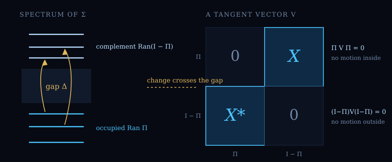 | 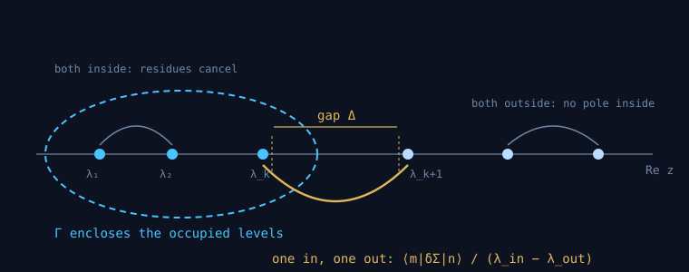 |
| **Figure 1.** Change crosses the gap: every tangent vector is block off-diagonal. | **Figure 2.** Where the tangent vector comes from: only pairs straddling the gap contribute. |
| 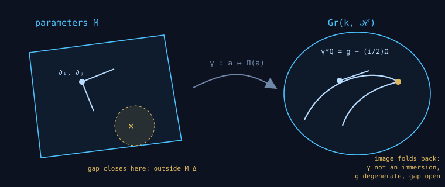 | 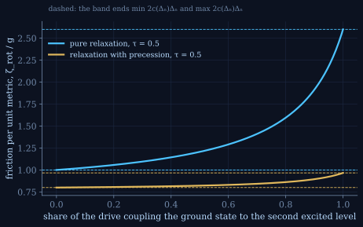 |
| **Figure 3.** A family of operators is a map into the Grassmannian. | **Figure 4.** The zero-temperature friction band of Theorem 5.3. |
| 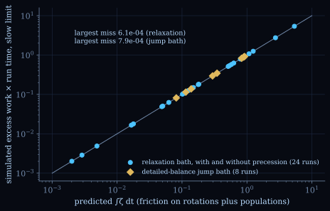 | 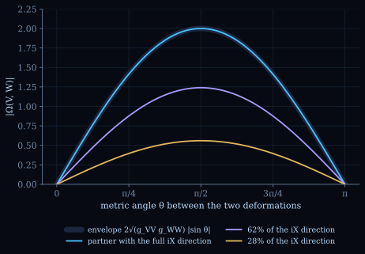 |
| **Figure 5.** Friction on projector rotations, tested against exact slow-driving simulations. | **Figure 6.** The envelope of Theorem 6.1: curvature cannot exceed what the metric affords. |
| 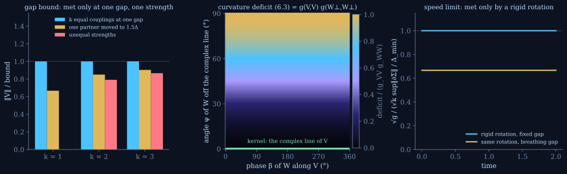 | 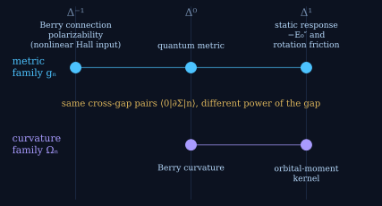 |
| **Figure 7.** When the bounds are met: one gap and one strength, the complex line, a rigid rotation. | **Figure 8.** One pair sum, many weights: metric, Berry connection polarizability, static response. |
| 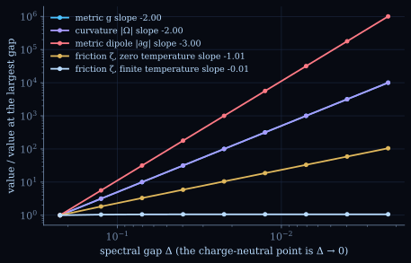 | 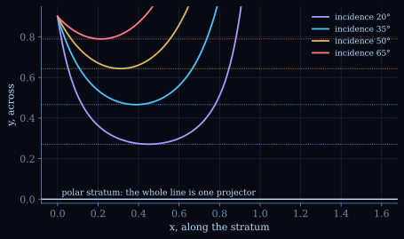 |
| **Figure 9.** Closing the gap: metric, curvature, dipole and friction scaling. | **Figure 10.** Total internal reflection at a polar stratum. |
| 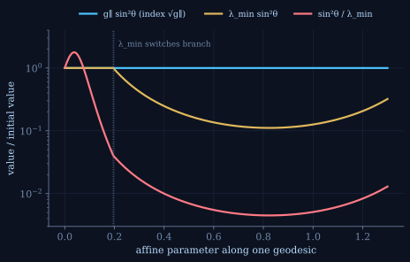 | 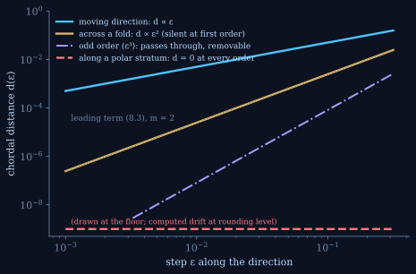 |
| **Figure 11.** Three candidate refractive indices along one geodesic. | **Figure 12.** Silent directions by order: ε for a moving direction, ε² across a fold, nothing along a polar stratum. |
| 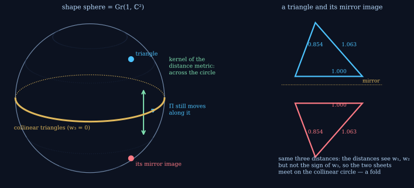 | 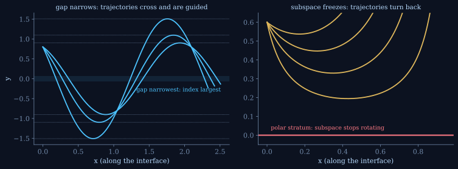 |
| **Figure 13.** Three bodies seen through their distances: the collinear circle of the shape sphere is a fold. | **Figure 14.** Two ways the index can vary across an interface, one refraction law. |
| 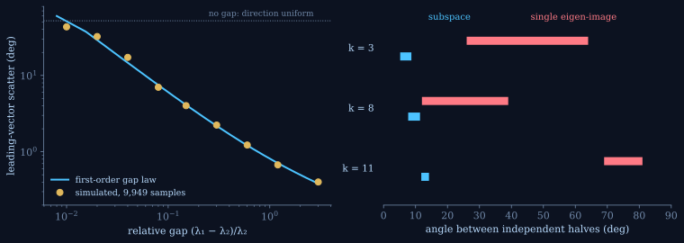 | 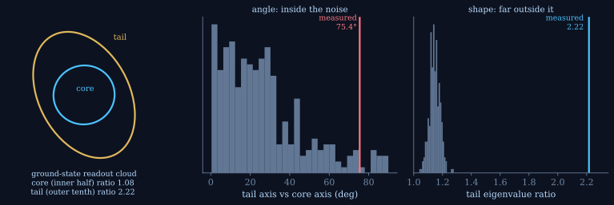 |
| **Figure 15.** The tip and the tail: the first-order gap law against simulation and condensate data. | **Figure 16.** A direction exists only where a gap exists (heat-engine readout). |
| 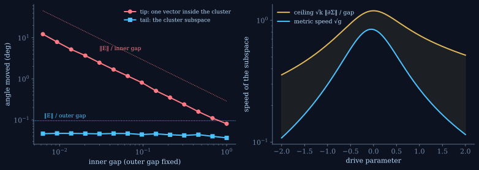 | 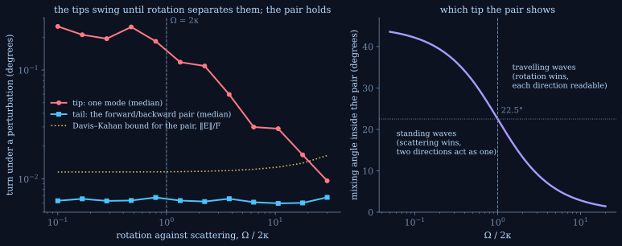 |
| **Figure 17.** One law at two grains: a vector inside a cluster turns while the cluster subspace holds. | **Figure 18.** Light going both ways round a ring: the tips swing until rotation separates them; the pair holds. |
| 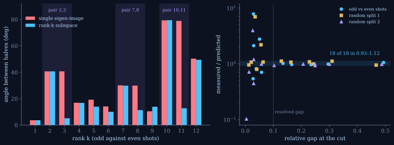 | 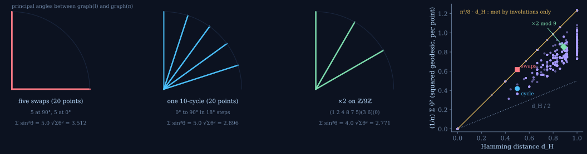 |
| **Figure 19.** The condensate, every cut: single eigen-image against rank-k subspace. | **Figure 20.** The card count and the intrinsic length; the upper bound is met by involutions only. Doubling on ℤ/9ℤ. |
| 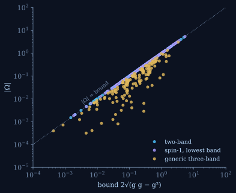 | 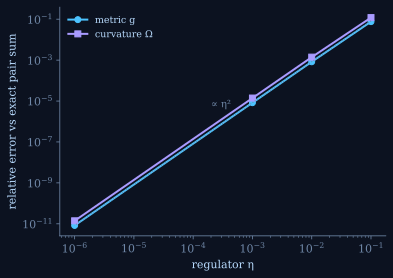 |
| **Figure 21.** Curvature against its bound: two-band and spin-1 bands saturate, generic three-band falls inside. | **Figure 22.** Krylov evaluation of the regularised metric and curvature, error ∝ η². |

## How it is checked

Every push runs [the proof check](.github/workflows/build.yml): build against Lean v4.34.1 and
Mathlib v4.34.1, independent replay in Lean's kernel checker, an axiom audit (only `propext`,
`Classical.choice`, `Quot.sound`), and six deliberately false statements that must fail.

## The paper

*Intrinsic Quantum Geometric Tensor on the Grassmannian and Spectral Lower Bounds on Dissipation*, Jeromie Beasley. DOI
[10.5281/zenodo.20768258](https://doi.org/10.5281/zenodo.20768258) (always opens the newest version). The current version is v7.3: [`paper/iqgt_grassmannian_v7_3.html`](paper/iqgt_grassmannian_v7.html), [`paper/iqgt_grassmannian_v7_3.pdf`](paper/iqgt_grassmannian_v7.pdf).

## Licence

Copyright (c) 2026 Jeromie Beasley. Code and proofs: [MIT](LICENSE). Written text:
[CC BY 4.0](LICENSE-CC-BY-4.0.md). See [`LICENSING.md`](LICENSING.md). Citation metadata is in
[`CITATION.cff`](CITATION.cff); how AI tools were used is stated in [`AI_USE.md`](AI_USE.md).
